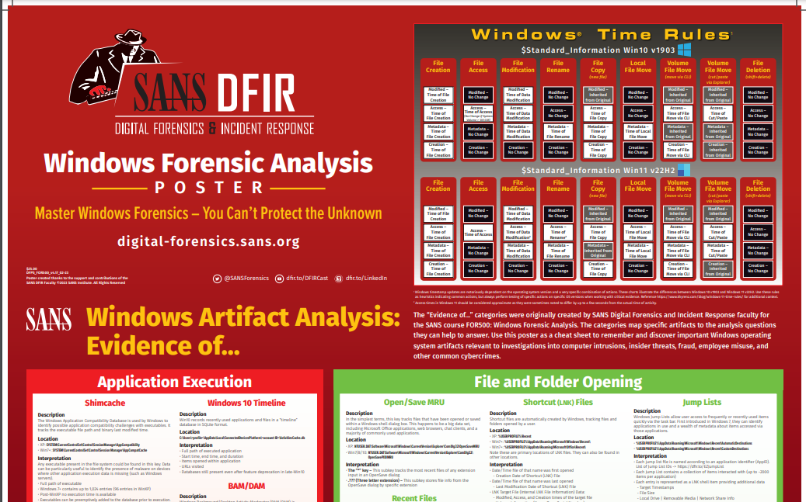
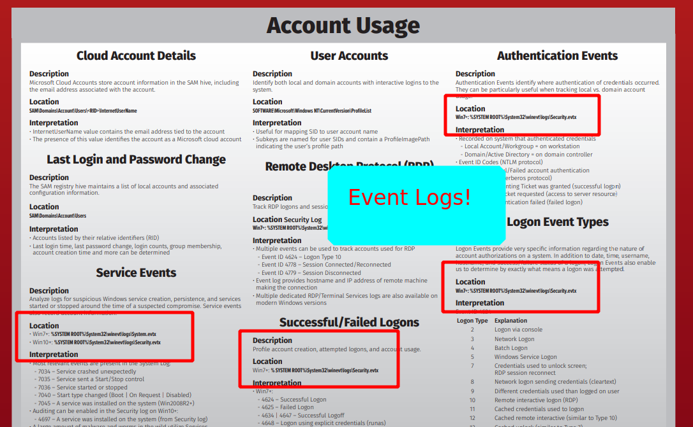

## DFIR Mind map

{caption="The SANS Windows Forensic Analysis Poster" cite="https://www.sans.org/posters/windows-forensic-analysis/"}

---

<!-- .slide: class="content" -->

## Event logs

---

<!-- .slide: class="content" -->

## Event logs

* Event logs are a huge source of forensic information!
* But they have some problems:

  * Rotation of event logs. By default event log size is very small
      (20 mb)
  * We can adjust the maximum size of log files through group policy
    or the registry.

---

<!-- .slide: class="content" -->

## Setting event log size

{}

---

<!-- .slide: class="content" -->

## Clearing the event logs

* Many attackers clear the event logs to frustrate forensic analysis.
   * Use Volume Shadow copies to periodically snapshot the disk
   * Forward events off the system, e.g. for SIEM or even built in
     Event Log forwarding.
   * Detect event log configuration modifications (Registry changes)

---

<!-- .slide: class="content" -->

## Forwarding event logs off the system

* The best practice for protecting event logs is to forward them off
  the system.

   * Built in facility within Windows: [Windows Event Forwarding (WEF)](https://learn.microsoft.com/en-us/windows/security/threat-protection/use-windows-event-forwarding-to-assist-in-intrusion-detection?source=recommendations)

   * Use agent like Elastic or Velociraptor

* Tuning which events to forward
  * Sending only relevant events means less volume
  * Indexing events on the server side may increase costs (can just
    forward for backup).

---

<!-- .slide: class="full_screen_diagram" -->

## Example: Forwarding Sysmon logs

{}

---

<!-- .slide: class="content" -->

## Disabling of event logs

* Attackers can actively change logging configuration

{}

---

<!-- .slide: class="content" -->

## What can we do with an agent?

* We can constantly check configuration for compliance

{}

---

<!-- .slide: class="content" -->

## What can we do with an agent?

* Real time alerting on configuration modifications

{}
