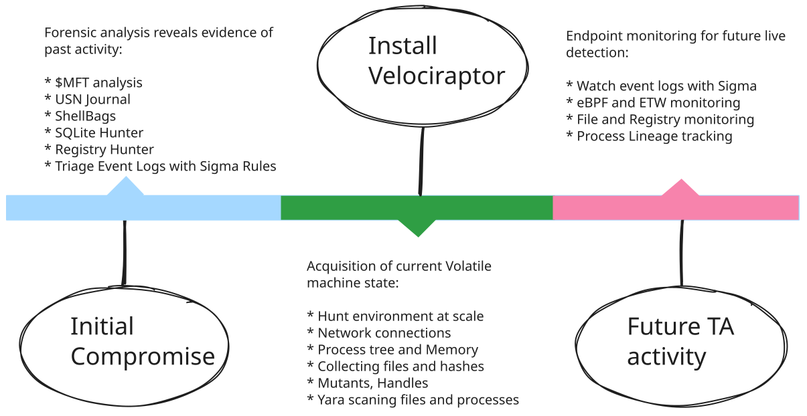
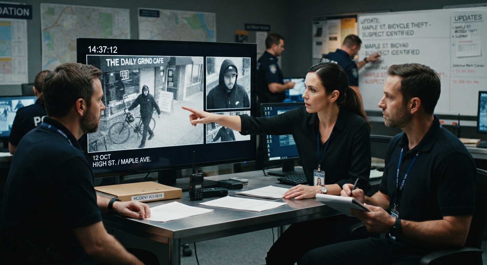
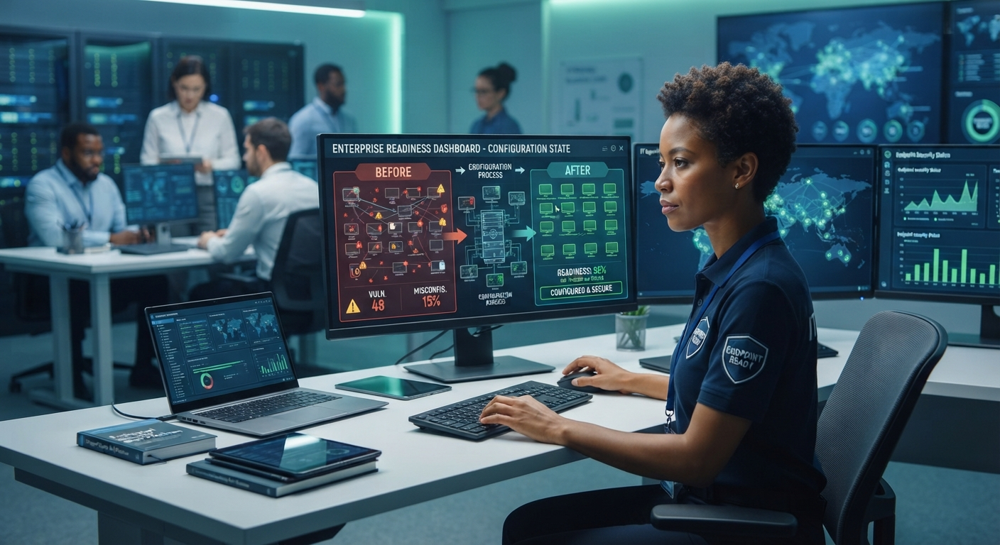
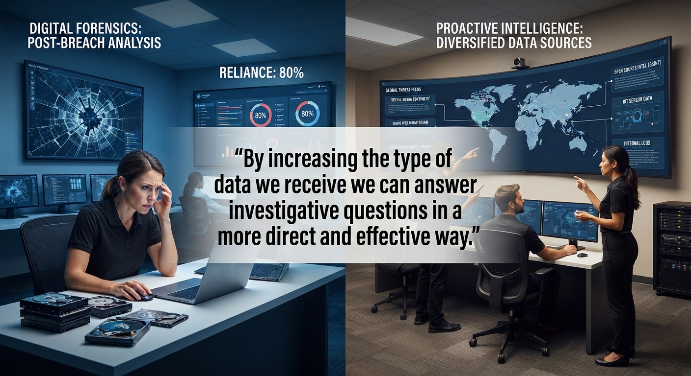
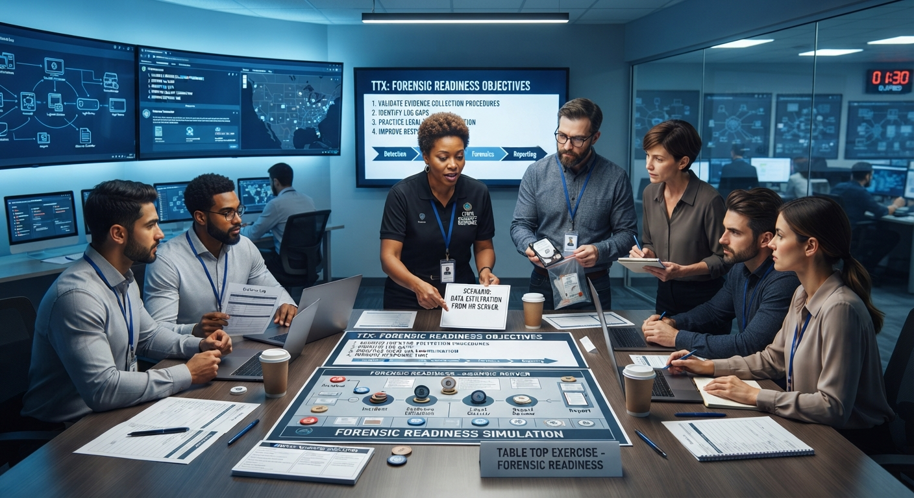
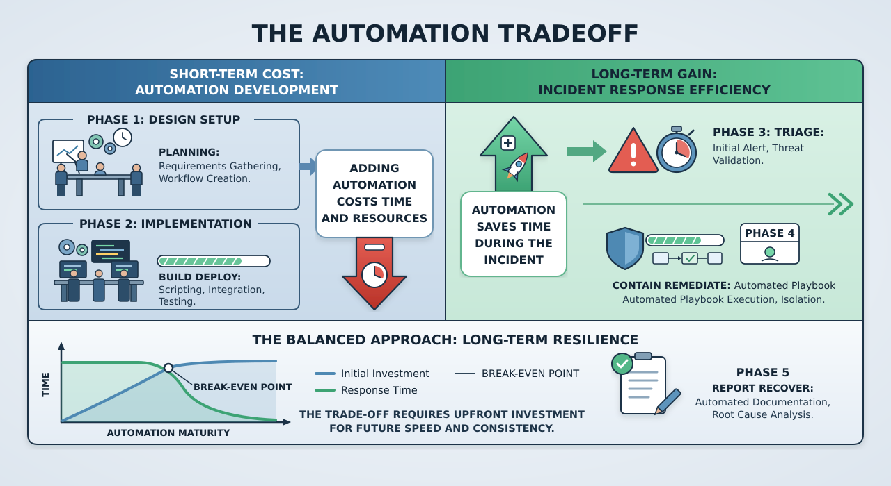
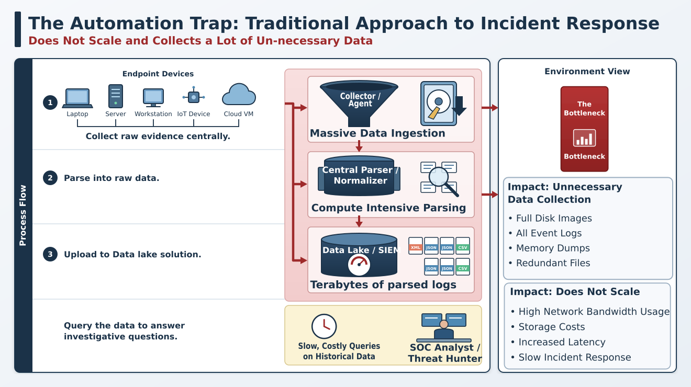
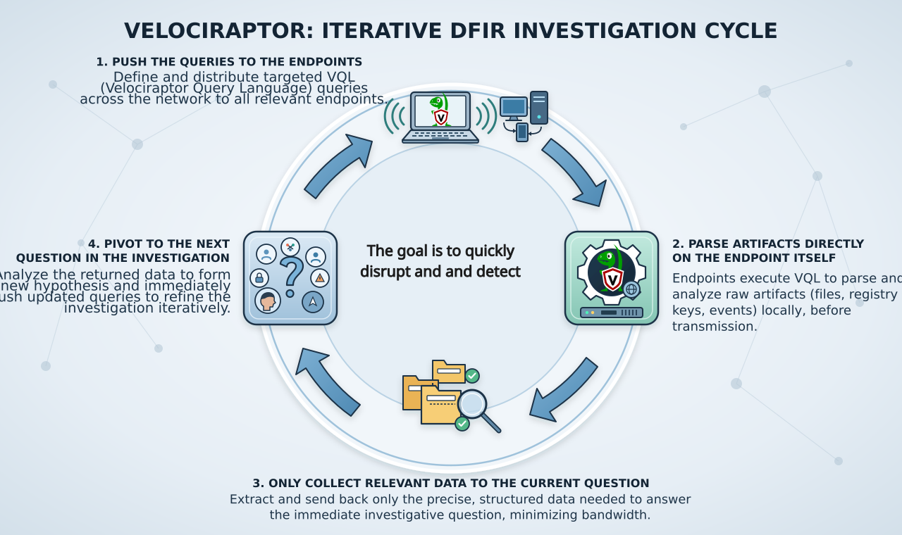

{}

---

## What is Incident Response?

> Incident response is the actions that an organization takes when it
> believes IT systems or data may have been breached. For example,
> security professionals will act if they see evidence of an
> unauthorized user, malware, or failure of security measures.
{cite="https://www.microsoft.com/en-au/security/business/security-101/what-is-incident-response" caption="What is incident response?"}

---

## The incident timeline

---

## Incident response goals

* Look into the past
   - What happened?
* What is happening now?
   - Which endpoints are currently compromised?
* Look into the future
   - How can we stop it from happening again
   - Can we detect further compromise?

---

## What is Digital Forensics?

> Digital forensics is the process of collecting, preserving, and
> analyzing digital evidence from various digital devices, including
> computers, mobile phones, and networks. In cybersecurity, digital
> forensics plays a crucial role in determining how a security breach
> occurred, potentially identifying the attackers, and ensuring the
> integrity of evidence for legal proceedings.
{cite="https://www.paloaltonetworks.com/cyberpedia/digital-forensics-and-incident-response" caption="The Role of Digital Forensics"}

---

## Is Digital Forensics Good enough?

* Many of the traditional Digital Forensics artifacts are not
  specifically designed for our needs.

* For example:
   * Prefetch files
      * Evidence of execution
   * Jumplists
      * Evidence of user actions
   * USB device insertion
      * Various registry keys

---

<!-- .slide: class="content" -->

## Other challenges

* Use of TRIM in physical drives make slack analysis useless!

* Operating systems are becoming hardened!
   * MacOS System Integrity Protections means we can not access some files.
   * Chromebooks anyone?
   * Ipads?

---

## Sometimes Digital Forensics is unsatisfying!

* Much of the time we arrive at the "crime scene" after the fact

* Try to reconstruct what happened from incidental information

* Forensics by its nature is **Making the best of a bad hand!**

---

## If we rely on Digital Forensics, we have already lost!

### In a perfect world we would not need Digital Forensics!

---

<!-- .slide: class="content" -->

## What if we could prepare for forensics?

* Sometimes we go into an incident unprepared, but a lot of the time
  we can prepare in advance!

  * In a corporate setting we can actually prepare for forensic
    investigation and incident response

  * Similar but orthogonal to system hardening

>  **Be Prepared:** Taking steps in advance to increase our chances of successfully
>  investigating an incident!

---

<!-- .slide: class="content" -->

## Forensic Readiness

> 1. Maximizing an environment's ability to collect credible digital
>    evidence
> 2. Minimizing the cost of forensics in an incident response.
{caption="Forensic Readiness John Tan @Stake (2001)" cite="https://citeseerx.ist.psu.edu/viewdoc/download?doi=10.1.1.480.6094&rep=rep1&type=pdf"}

---

<!-- .slide: class="content" -->

## Levels of preparedness

* Information security is a continuum and a tradeoff between
  resourcing and usability

* What can we do to improve our forensic readiness?

  * Simple things can be done cheaply!
     * Set configuration parameters in the environment.

  * More sophisticated things may involve more efforts
     * Install an agent, EDR etc.

* Consider how likely a forensic investigation will occur?
  * Tradeoff between cost and completeness
  * Table top exercises!

---

<!-- .slide: class="content" -->

## What types of interventions can we employ?

* Configuration change
  * Increases the system's ability to support forensic analysis

* Installation of EDR/Agents/Endpoint visibility software
  * Increases resilience against malicious anti-forensics.

---

## Increased readiness
### Through endpoint configuration

---

## Reimagine the forensic process

* Let's re-examine the digital forensic process critically

* Identify the things that can go wrong, the gaps and improvements

* Can we increase our chances of success?
   * Passive target: No deliberate interference with the DFIR process
   * Active Adversary: Employing Anti-Forensics to frustrate investigation

---

{}

---

## Increasing telemetry

---

## Live forensics

* Live agents allow for collection of volatile data:

    * Memory scanning for signatures
    * Handles, mutants etc.
    * Network connectiosn

* This information is often more direct and relevant
    * For example, consider **Prefetch** Vs. **PsList**

* Agent must be installed in advanced

---

## Forensic Preparedness
### The human element

---

## Preparing for an incident

* Table top exercises improve operational efficiency
   * Does my team know what to do in case of an incident?
   * What kinds of evidence should be used?
   * Who can we call on to help?

* Codify playbooks by incident types
   * Most incidents follow a common approach
   * A playbook helps to ensure we don't miss anything.

---

## Automation

{caption="<strong>Tradeoff&nbsp;</strong> Adding automation costs time and resources while automation saves time during the incident"}

---

## The Automation trap
###  Constantly evaluate the benefit of automation on the IR process.

* Tranditional approach:
   - Collect raw evidence centrally
   - Parse into raw data
   - Upload to Data lake solution
   - Query the data to answer investigative questions.

---

## Traditional IR

---

## Modern approach
### Treat the endpoint as the source of truth

{}

* Rather than collecting all the data into a central location:
   - Push the queries to the endpoints
   - Parse artifacts directly on the endpoint itself.
   - Only collect relevant data to the current question
   - Pivot to the next question in the investigation.

{}

---

## Conclusions

* Fail to plan = Plan to fail!

* Forensic Readiness is about planning and training for IR
  * Speed up response
  * Make the most of the available evidence sources

* No one source of evidence is perfect - tradeoffs everywhere

* While Digital Forensics is an exciting field - **It is a tool used for a higher goal.**

---

## Conclusions

Velociraptor is an advanced opensource DFIR framework that can be used
to improve your Forensics Readiness

{}
