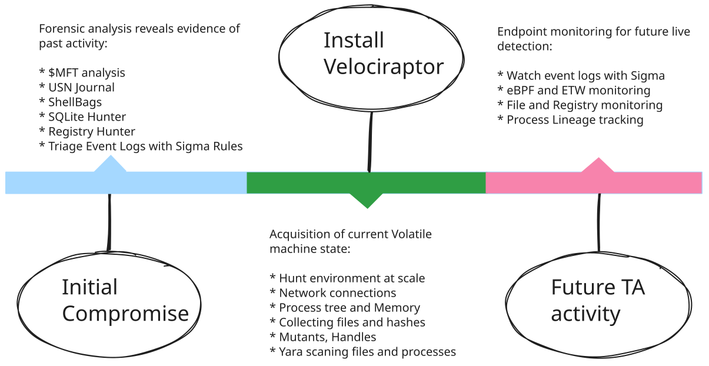
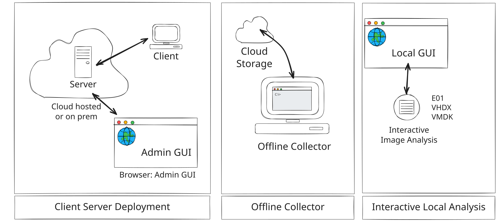
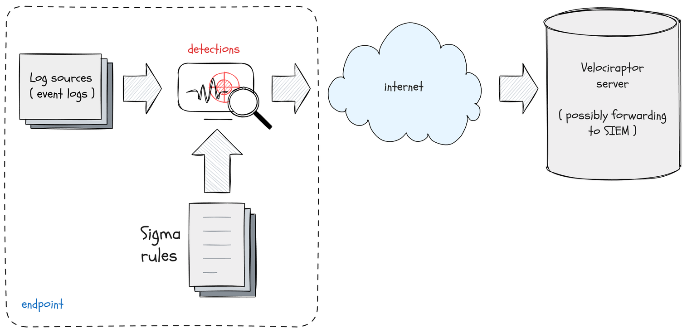
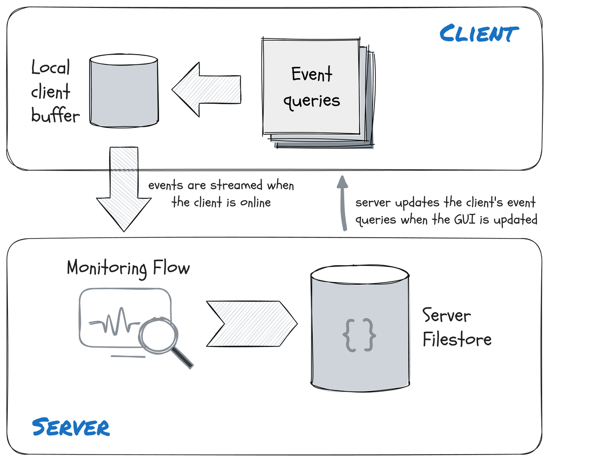
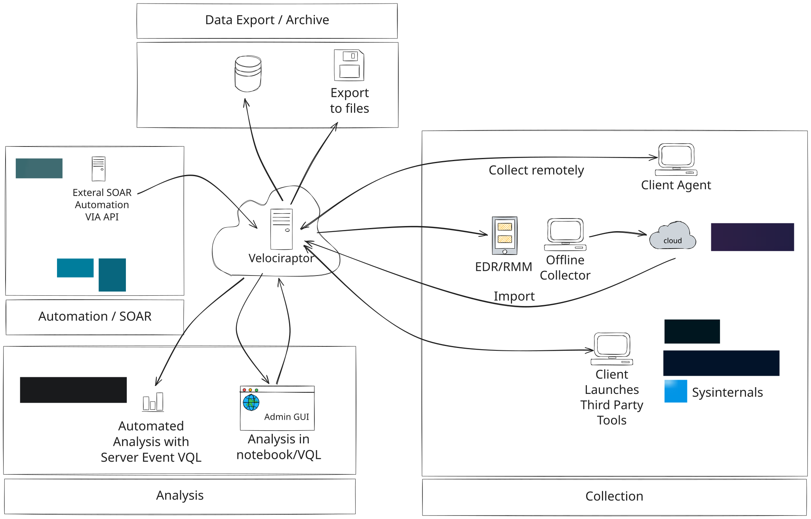

{}

---

## What is Velociraptor?
### A DFIR tool to handle every stage of the attack timeline

---

## How can I use Velociraptor?
### Flexible tool to handle every use case

---

## Scalable, fast, accurate

* Support Linux, Windows, MacOS, FreeBSD …
* Server simply collects the results of queries - clients do all the
  heavy lifting.
* Client memory and CPU usage is controlled via throttling and active
  cancellations.
* Server is optimized for speed and scalability
* Concurrency control ensures stability
* Bandwidth limits ensure network stability
* Single or multi-server modes (20k EP/server).

---

## Interactively investigate clients

Digital forensic plugins turn VQL into a high quality DFIR tool

{}

---

## Velociraptor Artifacts
### Artifacts encode VQL into user sharable code snippets

{}

---

## Hunts - Collecting at scale
### Collecting artifacts at scale from multiple endpoints

{}

---

## Postprocessing using Notebooks
### Collaborative shared VQL execution environments

{}

---

## Triaging Using Sigma

* Endpoint tools can directly evaluate Sigma rules on the event logs

---

##  Collecting the sigma artifact

{}

---

## Triaging an endpoint

{}

---

## Stacking rules by title

{}

---

## Viewing the stacking stats

{}

---

## Viewing common rows

{}

---

## Detection vs. Forensics

* VQL Sigma rules bridge detection with forensics.
* Forensics: `What happened here?`
    * Recover all the information - relevant or not
    * Get a full picture.

* Detection: `What bad things happened here?`
    * Take the forensic information and rapidly zero in on obvious bad
      signals.
    * Not designed to be exhaustive! Triage oriented

* Complimentary capabilities

---

## Real Time Sigma alerting
### VQL is fully asynchronous - real time queries.

{style="height: 50vh;"}

---

## Real Time Sigma alerting

### Configuring Velociraptor's client monitoring

{}

---

## Real Time Sigma alerting

### Configuring Velociraptor's client monitoring

{}

---

## Live detection with Sigma

{}

---

## Administration and automation

* All server administration tasks can be automated with VQL artifacts
* API access available for external automation
* Automatic upload of data to Elastic/Slack/Discord
* Open ended architecture enables novel use cases.

---

## The Velociraptor Ecosystem

---

{}
